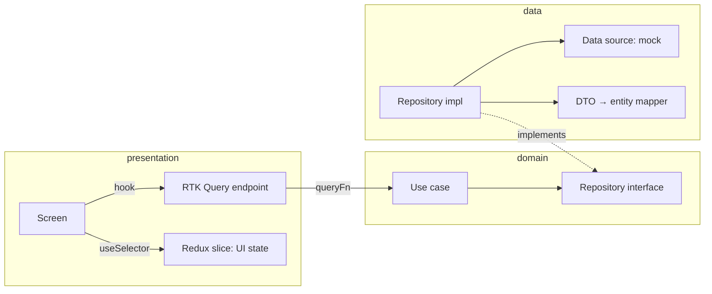

# Sovereign: Private Jet

A private jet booking app for Australia, built as a client demo. It covers:
- charters (the whole aircraft on any route)
- trips with cancellation
- payment cards and a wallet
- a concierge chat and notifications
- a member profile

Everything runs on in-memory mock data, so the app works offline with no backend.

## App identity

| | |
|---|---|
| App name (store listing, splash, about line) | **Sovereign: Private Jet** |
| Display name (under the icon) | **Sovereign**. The full name would be cut off under the icon. |
| Bundle id (iOS and Android) | `app.dd.private.jet` |
| App icon | [src/assets/images/app-icon.png](src/assets/images/app-icon.png), 1024 × 1024, the source of every launcher icon |
| Launch screen | The app icon centred on `#0B0B0C`: `ios/BackJet/LaunchScreen.storyboard`, and the `AppTheme.Launch` theme on Android (the system splash API on Android 12+) |

- The name lives in `src/core/app-identity.ts` (`APP_NAME`, `APP_FULL_NAME`) for the app, `CFBundleDisplayName` in `ios/BackJet/Info.plist`, `app_name` in `android/app/src/main/res/values/strings.xml` and `displayName` in `app.json`.
- The native project and module keep the old internal name `BackJet` (Xcode target, `app.json` `name`, the Kotlin package `com.backjet`). Users never see it, and renaming it would break the build for nothing.
- The logo images in `src/assets/images` still show the old BlackJet wordmark and need a new design.

## Screenshots

iPhone 17 Pro Max simulator. Full set, including the news story and payment cards: [docs/screenshots](docs/screenshots).

| | Home | Jets | Jet quote | Checkout | Booked |
|---|---|---|---|---|---|
| Light |  |  |  |  |  |
| Dark |  |  |  |  |  |

| | Trips | Trip | Concierge | Profile | Add card |
|---|---|---|---|---|---|
| Light |  |  |  |  |  |
| Dark |  |  |  |  |  |

## Demo account

The app opens already signed in as **Alexander Reed** (Black Card). After signing out, the login screen offers:
- **Continue with Demo Account**
- Apple and Google buttons, which also sign in to the demo account
- the form with `demo@blackjet.app` / `blackjet123`

## What to show in a demo

1. **Home.** Search a round trip (for example GVA → NCE, 2 passengers), or tap a popular route to fill the airports.
   - Scrolling down turns the form into a floating pill; dragging back up brings the whole form back.
   - The jets open on their own screen. Open a jet and choose it for both legs; the selection bar shows the total.
2. **Checkout.** Pick departure times and the party, then pay with a card or the wallet.
   - The confirmation draws a success mark.
   - **View trip** opens it in Trips.
3. **Trips.** Upcoming and past trips as boarding passes.
   - A trip more than 24 h away can be cancelled.
4. **Inbox** (chat and bell on Home).
   - The concierge chat answers by topic: try "catering", "dog" or "car".
   - In notifications, a crew update opens its trip.
   - Tap a news story for the full article.
5. **Profile.** Edit personal information, add a card (it turns over while the security code is typed), set the default, toggle notifications, read the FAQ, sign out.

| | |
|---|---|
| Stack | React Native 0.88 (New Architecture), Redux Toolkit, RTK Query, Reanimated 4, Clean Architecture |
| Navigation | React Navigation 7: native bottom tabs (Liquid Glass on iOS 26) + native stack |
| Tests | Jest + React Native Testing Library 14 |

## Commands

Clone with the shared scripts: `git clone --recurse-submodules <repo>`, or run `make set-up`, which fetches them. `make` lists every target.

| Task | Command |
|---|---|
| Setup | `make set-up` (`NO_PULL=1` skips `git pull`) |
| Run | `make run-ios` (`SIMULATOR="iPhone 17 Pro"`) / `make run-android` |
| Version and build number | Edit [app-version.json](app-version.json), then `make version`; or `make bump-build`, `make bump-patch` / `bump-minor` / `bump-major`, `make set-version V=1.2.0`. Add `P=ios` or `P=android` for one platform |
| Release to TestFlight | `make release-ios-dev` (`NOTE="What to test"`), after filling `ios/fastlane/.env` |
| Checks | `npm run lint && npm run typecheck && npm test` |
| Full run guide | [docs/setup.md](docs/setup.md) |

**Version.** [app-version.json](app-version.json) is the only place versions are set, with a pair per platform: `iosVersion`/`iosBuild` and `androidVersion`/`androidBuild`. Keep the two versions the same unless a store needs otherwise; the build numbers count on their own, since each store only checks its own.
- Android (`android/app/build.gradle`) reads its pair directly; so does the app (`src/core/app-version.ts`, the Profile footer), for the platform it runs on.
- The Xcode project cannot, so `make version` copies the iOS pair into `MARKETING_VERSION` and `CURRENT_PROJECT_VERSION`. `make run-ios`/`run-android` run it first, and a test fails if they drift.
- A TestFlight release still uses the next free build number from App Store Connect, not `iosBuild`.

The targets come from [script-tools](https://github.com/DAMHONGDUC/script-tools) `react_native/` (submodule at `packages/script-tools`); this app's settings for it are in `script-tools.properties`.

## Architecture

Feature-first Clean Architecture. Each feature has three layers; dependencies point inward.



| Layer | Holds | Knows Redux / React? |
|---|---|---|
| `domain/` | Entities, repository interfaces, use cases, business rules | No |
| `data/` | DTOs, mappers, data sources (mock today), repository implementations | No |
| `presentation/` | RTK Query endpoints, slices, screens, components | Yes |
| `src/app/` | Composition root (`di/container.ts`), store, navigation | Yes |

### How RTK Query fits

- One `createApi` with `fakeBaseQuery` (`src/core/store/base-api.ts`): no endpoint calls HTTP itself.
- Every endpoint's `queryFn` calls a use case, which it receives as the thunk `extra` (`createAppStore` injects the use cases).
- RTK Query still owns caching, request de-duplication, tags, refetching and the `useXxxQuery` / `useXxxMutation` hooks.
- Errors thrown below are mapped to a serializable `AppError` by `runQuery` (`src/core/query/run-query.ts`).
- Slices hold UI state only (the flight and charter search forms, recent searches and airports); server data lives in the RTK Query cache.

### Cache invalidation

| Mutation | Invalidates | Refetches |
|---|---|---|
| `bookFlight` | `Flight:<id>`, `Flight:LIST`, `Booking`, `Payment:LIST` | The flight's seats, the flight list, Trips and the wallet balance |
| `bookCharter` | `Booking`, `Payment:LIST` | Trips and the wallet balance |
| `cancelBooking` | `Booking:<id>`, `Booking` | The trip and Trips |
| `addCard`, `setDefaultPayment`, `removeCard` | `Payment:LIST` | Payment methods everywhere |
| `markNotificationRead`, `markMessagesRead` | `Notification`, `Message` | The lists and the home badges (marking read is optimistic) |
| `sendMessage` | none | Optimistic: the member's bubble shows at once, then the thread with the reply replaces the cache |
| `signIn`, `signOut`, `updateProfile` | none | The session slice follows them through matchers |

### Mock data

Mock data lives in each feature's data layer: `data/datasources/mock/*.mock.ts` builds DTOs dated from "now", and `*MockDataSource` serves them in memory with a fake network delay. Bookings and seat counts change in memory for the session. To use a real backend, write an HTTP data source with the same interface and swap it in `src/app/di/container.ts`; nothing above the data layer changes.

Ready for that swap:

- `src/core/http/http-client.ts`: fetch with a base URL, a timeout, the RTK `signal`, JSON, and status → `DomainError` (401 Unauthorized, 404 NotFound, 409/422 Validation, no connection Network).
- `src/core/http/token-store.ts`: where the bearer token lives (in memory for now; a keychain-backed store is the real choice). A 401 clears it, and any `UNAUTHORIZED` API error signs the member out in `session-slice`.
- Booking is one call, `BookingRepository.placeBooking`, with an idempotency key per checkout attempt: the backend charges, takes the seats and records the booking together. The mock does it in steps behind that one method.
- `imageFor` takes a bundled key or an http(s) URL.
- The open chat polls `getMessages` every `CHAT_POLL_MS`, so a concierge reply that comes later shows up.

## Features

More detail per screen: [feature-docs/app/README.md](feature-docs/app/README.md).

| Feature | Screens | Animation |
|---|---|---|
| Auth | Splash, login (form, demo account, Apple/Google) | Form shakes on error, fade between signed-in and signed-out stacks |
| Dashboard | Charter search (one-way, round-trip, multi-city), popular routes, news carousel and full story; search results, jet quote and charter checkout on their own screens ([spec](feature-docs/dashboard/README.md)) | Search form turns into a floating pill on scroll; parallax photo headers; shimmer skeletons; Lottie empty state |
| Booking | Trips (upcoming/past), trip detail with cancellation, confirmation, payment picker | Segmented control slides, success mark |
| Inbox | Notifications, concierge chat | Unread dots fade out, typing dots |
| Profile | Profile with stats, personal information, payment cards, add card, help/FAQ, terms | Card flips while the CVC is typed, FAQ accordion |

## Folder layout

```
src/
  app/            App.tsx, di/container.ts, store/, navigation/
  core/           error/, query/, store/base-api.ts, theme/, ui/, utils/
  features/
    <feature>/
      domain/       entities/, repositories/, usecases/
      data/         datasources/ (+ mock/), models/, mappers/, repositories/
      presentation/ <feature>-api.ts, slices, screens/, components/
__tests__/        same tree as src/ (core/, features/<feature>/...), plus smoke.test.tsx
  test-utils/     test store with zero latency and a fixed clock (import as @test-utils/...)
```

Screens take callbacks (`onOpenFlight`, `onBooked`) instead of a navigation prop; `src/app/navigation` adapts routes to them.

Every screen uses the same look:
- colours from `AppColors` (`src/core/theme/app-colors.ts`): light and dark palettes, read through `useBlackJetTheme()`. The member picks System, Light or Dark in Profile.
- gaps from `AppSpacing` (`src/core/theme/app-spacing.ts`)
- `makeStyles()` (`src/core/theme/blackjet.ts`) for themed style sheets
- KnulTrial and the icon fonts from `src/assets/fonts`
- English and Vietnamese text from `src/core/i18n`

`src/core/theme/theme.ts` holds only radii, the type scale and press timing.

UI rules (colours, spacing, bottom actions, theme, language) are in [feature-docs/app](feature-docs/app/README.md#ui-rules).

## Remaining work

See [docs/remaining-work.md](docs/remaining-work.md).
