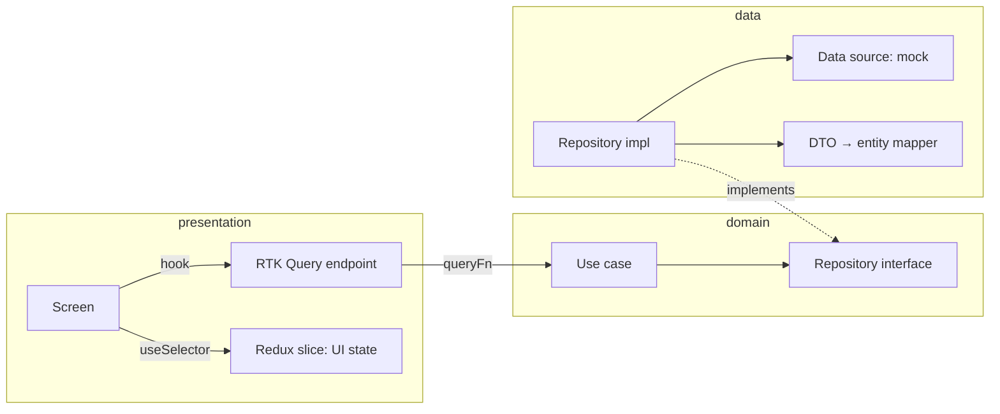

# BackJet

A private jet booking app: a dashboard, a flight search and a booking flow, on mock data.

| | |
|---|---|
| Stack | React Native 0.88 (New Architecture), Redux Toolkit, RTK Query, Reanimated 4, Clean Architecture |
| Navigation | React Navigation 7: bottom tabs + native stack |
| Tests | Jest + React Native Testing Library 14 |

## Commands

| Task | Command |
|---|---|
| Install | `npm ci` (then `bundle install && cd ios && bundle exec pod install` for iOS) |
| Metro | `npm start` |
| Run | `npm run android` / `npm run ios` |
| Checks | `npm run lint && npm run typecheck && npm test` |
| Full run guide | [docs/setup.md](docs/setup.md) |

## Architecture

Feature-first Clean Architecture. Each feature has three layers; dependencies point inward.



| Layer | Holds | Knows Redux / React? |
|---|---|---|
| `domain/` | Entities, repository interfaces, use cases, business rules | No |
| `data/` | DTOs, mappers, data sources (mock today), repository implementations | No |
| `presentation/` | RTK Query endpoints, slices, screens, components | Yes |
| `src/app/` | Composition root (`di/container.ts`), store, navigation | Yes |

### How RTK Query fits

- One `createApi` with `fakeBaseQuery` (`src/core/store/base-api.ts`): no endpoint calls HTTP itself.
- Every endpoint's `queryFn` calls a use case, which it receives as the thunk `extra` (`createAppStore` injects the use cases).
- RTK Query still owns caching, request de-duplication, tags, refetching and the `useXxxQuery` / `useXxxMutation` hooks.
- Errors thrown below are mapped to a serializable `AppError` by `runQuery` (`src/core/query/run-query.ts`).
- Slices hold UI state only (the flight filters); server data lives in the RTK Query cache.

### Cache invalidation

| Mutation | Invalidates | Refetches |
|---|---|---|
| `bookFlight` | `Flight:<id>`, `Flight:LIST`, `Booking` | The flight's seats, the flight list, Trips, and the Dashboard (it provides `Booking` too) |

### Mock data

Mock data lives in each feature's data layer: `data/datasources/mock/*.mock.ts` builds DTOs dated from "now", and `*MockDataSource` serves them in memory with a fake network delay. Bookings and seat counts change in memory for the session. To use a real backend, write an HTTP data source with the same interface and swap it in `src/app/di/container.ts`; nothing above the data layer changes.

## Features

| Feature | Screens | Reanimated |
|---|---|---|
| Dashboard | Loyalty, stats, next trip, monthly spend | Collapsing header on scroll, stretch/parallax loyalty card, animated tier progress, bars that grow in turn, staggered cards |
| Flights | List with filters, detail | Staggered list entry, press-scale cards, plane flying the route |
| Booking | Form, confirmation, Trips | Animated passenger fields (enter/exit/layout), animated total, success mark (spring disc, tick, pulse ring) |

## Folder layout

```
src/
  app/            App.tsx, di/container.ts, store/, navigation/
  core/           error/, query/, store/base-api.ts, theme/, ui/, utils/
  features/
    <feature>/
      domain/       entities/, repositories/, usecases/
      data/         datasources/ (+ mock/), models/, mappers/, repositories/
      presentation/ <feature>-api.ts, slices, screens/, components/
  test-utils/     test store with zero latency and a fixed clock
```

Screens take callbacks (`onOpenFlight`, `onBooked`) instead of a navigation prop; `src/app/navigation` adapts routes to them.
