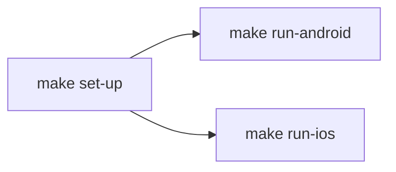

# Run the app

## Requirements

| Tool | Version | Source |
|---|---|---|
| Node.js | >= 22.11.0 | `package.json` → `engines` |
| npm | Bundled with Node | `package-lock.json` |
| Ruby | >= 2.6.10 | `Gemfile` |
| CocoaPods | >= 1.13 (not 1.15.0 / 1.15.1), installed through Bundler | `Gemfile` |
| fastlane | >= 2.228, installed through Bundler; only for `make release-ios-dev` | `Gemfile` |
| make | Any (ships with the Xcode command line tools) | `Makefile` |
| Xcode | Any version that supports iOS 15.1 (macOS only) | `ios/BackJet.xcodeproj` → `IPHONEOS_DEPLOYMENT_TARGET` |
| JDK | 17 (TODO: confirm) | Not pinned in repo |
| Android SDK | Platform 37, Build Tools 37.0.0 | `android/build.gradle` |
| Android NDK | 27.1.12297006 | `android/build.gradle` |
| Android device / emulator | API 24+ | `android/build.gradle` → `minSdkVersion` |

## First run

| # | Command | What it does |
|---|---|---|
| 1 | `make set-up` | `git submodule update --init --recursive`, `git pull --ff-only`, `npm ci`, then on macOS `bundle install`, removes `ios/Pods`, `ios/Podfile.lock` and `ios/build`, and runs `pod install --repo-update` ([react_native/set_up.sh](../packages/script-tools/react_native/set_up.sh)). `NO_PULL=1` skips the pull; `npm run setup` runs the same |
| 2 | `npm run android` | Build, install and open the app on an emulator or device; starts Metro if it is not running |
| 3 | `npm run ios` | Build and open the app in the iOS Simulator (macOS only); starts Metro if it is not running |

| When to re-run `make set-up` |
|---|
| After cloning or pulling changes to `package-lock.json` |
| After adding a native dependency |
| After switching branches |

## Commands

| Command | What it does |
|---|---|
| `npm run setup` | `make set-up` |
| `npm run setup:ios` | `make set-up run-ios` |
| `npm run setup:android` | `make set-up run-android` |
| `npm start` | Start the Metro bundler on its own |
| `npm start -- --reset-cache` | Start Metro with a clean cache |
| `npm run android` | Build and install the debug app on Android |
| `npm run ios` | Build and launch the debug app in the iOS Simulator |
| `npm run lint` | ESLint |
| `npm run typecheck` | `tsc --noEmit` |
| `npm test` | Jest + React Native Testing Library |

## Make targets

The targets come from [script-tools](https://github.com/DAMHONGDUC/script-tools) `react_native/react_native.mk` (submodule at `packages/script-tools`); its settings for this app are in `script-tools.properties`.

| Target | What it does |
|---|---|
| `make` | Lists the targets |
| `make set-up` | Submodules, `git pull --ff-only`, `npm ci`, `bundle install`, clean `pod install` |
| `make run-ios` | `npx react-native run-ios`; `SIMULATOR="iPhone 17 Pro"` picks the simulator |
| `make run-android` | `npx react-native run-android` |
| `make release-ios-dev` | Archives the Release build, signs it for the App Store, uploads it to TestFlight and copies it to `Release/dev-backjet-<version>-<build>.ipa` ([react_native/release_ios.sh](../packages/script-tools/react_native/release_ios.sh), lane in [react_native/fastlane/Fastfile](../packages/script-tools/react_native/fastlane/Fastfile), imported by `ios/fastlane/Fastfile`). `NOTE="..."` sets What to Test |

### TestFlight release setup (once per machine)

1. `cp ios/fastlane/.env.example ios/fastlane/.env`.
2. Fill in `IOS_TEAM_ID`, `ASC_KEY_ID`, `ASC_ISSUER_ID`.
3. Put the App Store Connect API key (`AuthKey_<id>.p8`, role App Manager) at `ios/fastlane/AuthKey.p8`, or point `ASC_KEY_FILEPATH` at it. In CI, set `ASC_KEY_CONTENT` to its base64 content instead.
4. The app `app.dd.private.jet` must exist in App Store Connect.

Signing is automatic: the API key lets Xcode create the certificate and profiles, so no Apple ID has to be logged into Xcode. The build number is TestFlight's latest for the version plus one, passed to the build only; the project keeps `CURRENT_PROJECT_VERSION = 1`. To ship a new version, change `MARKETING_VERSION` in the Xcode project.

## Configuration

| Item | Value |
|---|---|
| Env variables | None; all data comes from in-memory mocks (`src/features/*/data/datasources/mock/`) and resets when the app restarts |
| Demo account | Signed in at launch; after signing out use `demo@blackjet.app` / `blackjet123` or **Continue with Demo Account** |
| Data source swap | `src/app/di/container.ts` |
| Import alias | `@/` → `src/` (`babel.config.js`, `tsconfig.json`) |
| Fonts | `src/assets/fonts`, linked into `android/app/src/main/assets/fonts` and the iOS project by `npx react-native-asset` (`react-native.config.js`); re-run it after adding a font. File names match PostScript names, so `fontFamily` is the same on both platforms |
| New Architecture / Hermes | Enabled (`android/gradle.properties`) |

## Troubleshooting

| Symptom | Fix |
|---|---|
| Reanimated / worklets error after editing `babel.config.js` | `npm start -- --reset-cache` (`react-native-worklets/plugin` must stay last in `plugins`) |
| `@/...` import cannot be resolved | `npm start -- --reset-cache` |
| iOS build fails on missing pods | `make set-up` |
| Android build cannot find SDK | Set `ANDROID_HOME`, or add `sdk.dir` to `android/local.properties` |
| Wrong app after switching branch | Stop Metro, `make set-up`, then `npm start -- --reset-cache` |
| Icons show as boxes or text in the wrong font | The fonts are not in the build: `npx react-native-asset`, then rebuild the app (fonts are native assets, Metro reload is not enough) |
| `lottie-react-native` / `react-native-haptic-feedback` not found at runtime | Native modules: `make set-up` (pods on iOS), then rebuild |
