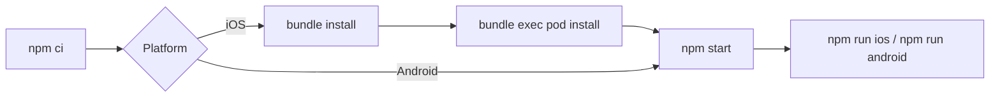

# Run the app

## Requirements

| Tool | Version | Source |
|---|---|---|
| Node.js | >= 22.11.0 | `package.json` → `engines` |
| npm | Bundled with Node | `package-lock.json` |
| Ruby | >= 2.6.10 | `Gemfile` |
| CocoaPods | >= 1.13 (not 1.15.0 / 1.15.1), installed through Bundler | `Gemfile` |
| Xcode | Any version that supports iOS 15.1 (macOS only) | `ios/BackJet.xcodeproj` → `IPHONEOS_DEPLOYMENT_TARGET` |
| JDK | 17 (TODO: confirm) | Not pinned in repo |
| Android SDK | Platform 37, Build Tools 37.0.0 | `android/build.gradle` |
| Android NDK | 27.1.12297006 | `android/build.gradle` |
| Android device / emulator | API 24+ | `android/build.gradle` → `minSdkVersion` |

## First run

| Step | Command | Note |
|---|---|---|
| 1. Clone | `git clone https://github.com/DAMHONGDUC/private-jet.git && cd private-jet` | |
| 2. Install JS deps | `npm ci` | Uses `package-lock.json` |
| 3. Install CocoaPods (iOS) | `bundle install` | Run at repo root, once |
| 4. Install pods (iOS) | `cd ios && bundle exec pod install && cd ..` | Re-run after adding a native dependency |
| 5. Start Metro | `npm start` | Keep this terminal open |
| 6a. Run Android | `npm run android` | In a second terminal, with an emulator or device connected |
| 6b. Run iOS | `npm run ios` | In a second terminal, macOS only |

## Commands

| Command | What it does |
|---|---|
| `npm start` | Start the Metro bundler |
| `npm start -- --reset-cache` | Start Metro with a clean cache |
| `npm run android` | Build and install the debug app on Android |
| `npm run ios` | Build and launch the debug app in the iOS Simulator |
| `npm run lint` | ESLint |
| `npm run typecheck` | `tsc --noEmit` |
| `npm test` | Jest + React Native Testing Library |

## Configuration

| Item | Value |
|---|---|
| Env variables | None; all data comes from in-memory mocks (`src/features/*/data/datasources/mock/`) |
| Data source swap | `src/app/di/container.ts` |
| Import alias | `@/` → `src/` (`babel.config.js`, `tsconfig.json`) |
| New Architecture / Hermes | Enabled (`android/gradle.properties`) |

## Troubleshooting

| Symptom | Fix |
|---|---|
| Reanimated / worklets error after editing `babel.config.js` | `npm start -- --reset-cache` (`react-native-worklets/plugin` must stay last in `plugins`) |
| `@/...` import cannot be resolved | `npm start -- --reset-cache` |
| iOS build fails on missing pods | `cd ios && bundle exec pod install` |
| Android build cannot find SDK | Set `ANDROID_HOME`, or add `sdk.dir` to `android/local.properties` |
| Wrong app after switching branch | Stop Metro, `npm ci`, then `npm start -- --reset-cache` |
