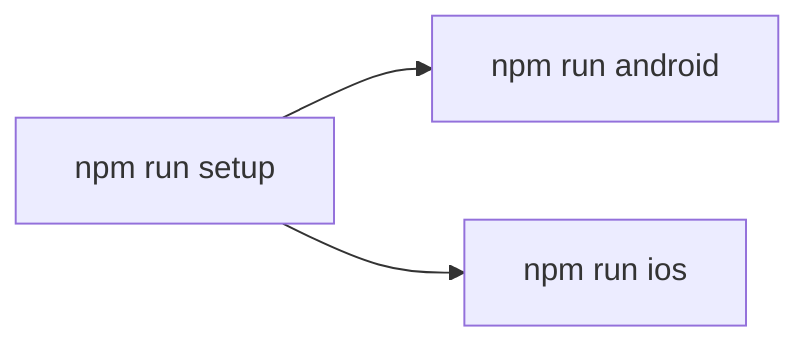

# Run the app

## Requirements

| Tool | Version | Source |
|---|---|---|
| Node.js | >= 22.11.0 | `package.json` → `engines` |
| npm | Bundled with Node | `package-lock.json` |
| Ruby | >= 2.6.10 | `Gemfile` |
| CocoaPods | >= 1.13 (not 1.15.0 / 1.15.1), installed through Bundler | `Gemfile` |
| Xcode | Any version that supports iOS 15.1 (macOS only) | `ios/BackJet.xcodeproj` → `IPHONEOS_DEPLOYMENT_TARGET` |
| JDK | 17 (TODO: confirm) | Not pinned in repo |
| Android SDK | Platform 37, Build Tools 37.0.0 | `android/build.gradle` |
| Android NDK | 27.1.12297006 | `android/build.gradle` |
| Android device / emulator | API 24+ | `android/build.gradle` → `minSdkVersion` |

## First run

| # | Command | What it does |
|---|---|---|
| 1 | `npm run setup` | `git pull --ff-only`, `npm ci`, then on macOS `bundle install`, removes `ios/Pods`, `ios/Podfile.lock` and `ios/build`, and runs `pod install --repo-update` ([scripts/setup.js](../scripts/setup.js)). `npm run setup:ios` / `npm run setup:android` also build and open the app; add `-- --no-pull` to skip the pull |
| 2 | `npm run android` | Build, install and open the app on an emulator or device; starts Metro if it is not running |
| 3 | `npm run ios` | Build and open the app in the iOS Simulator (macOS only); starts Metro if it is not running |

| When to re-run `npm run setup` |
|---|
| After cloning or pulling changes to `package-lock.json` |
| After adding a native dependency |
| After switching branches |

## Commands

| Command | What it does |
|---|---|
| `npm run setup` | Pull, install JS deps, clean-install iOS pods |
| `npm run setup:ios` | Setup, then `npm run ios` |
| `npm run setup:android` | Setup, then `npm run android` |
| `npm start` | Start the Metro bundler on its own |
| `npm start -- --reset-cache` | Start Metro with a clean cache |
| `npm run android` | Build and install the debug app on Android |
| `npm run ios` | Build and launch the debug app in the iOS Simulator |
| `npm run lint` | ESLint |
| `npm run typecheck` | `tsc --noEmit` |
| `npm test` | Jest + React Native Testing Library |

## Configuration

| Item | Value |
|---|---|
| Env variables | None; all data comes from in-memory mocks (`src/features/*/data/datasources/mock/`) |
| Data source swap | `src/app/di/container.ts` |
| Import alias | `@/` → `src/` (`babel.config.js`, `tsconfig.json`) |
| Fonts | `src/assets/fonts`, linked into `android/app/src/main/assets/fonts` and the iOS project by `npx react-native-asset` (`react-native.config.js`); re-run it after adding a font. File names match PostScript names, so `fontFamily` is the same on both platforms |
| New Architecture / Hermes | Enabled (`android/gradle.properties`) |

## Troubleshooting

| Symptom | Fix |
|---|---|
| Reanimated / worklets error after editing `babel.config.js` | `npm start -- --reset-cache` (`react-native-worklets/plugin` must stay last in `plugins`) |
| `@/...` import cannot be resolved | `npm start -- --reset-cache` |
| iOS build fails on missing pods | `npm run setup` |
| Android build cannot find SDK | Set `ANDROID_HOME`, or add `sdk.dir` to `android/local.properties` |
| Wrong app after switching branch | Stop Metro, `npm run setup`, then `npm start -- --reset-cache` |
| Icons show as boxes or text in the wrong font | The fonts are not in the build: `npx react-native-asset`, then rebuild the app (fonts are native assets, Metro reload is not enough) |
| `lottie-react-native` / `react-native-haptic-feedback` not found at runtime | Native modules: `npm run setup` (pods on iOS), then rebuild |
