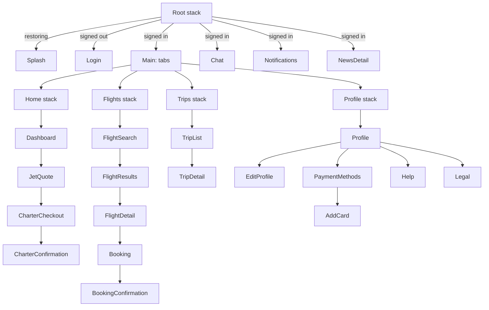

# BackJet app: screens, flows and mock data

Companion to [feature-docs/dashboard](../dashboard/README.md), which specifies the home screen in detail. This page covers the rest of the app and how the screens connect.

## Navigation

- Types live in `src/app/navigation/types.ts`.
- Screens never take a navigation prop. Each takes callbacks (`onBooked`, `onOpenTrip`, ...), and the `*Navigator.tsx` files adapt routes to them.
- Inbox screens and full stories sit in the root stack, so they cover the tab bar.
- Cross-tab jumps use nested params with `initial: false`, so Back lands on the tab's list.
  - Examples: a confirmation's **View trip**, and a notification about a trip.

## Session

| State | Shown | Changes on |
|---|---|---|
| `restoring` | Splash | `restoreSession` answers |
| `signedIn` | Main and the inbox screens | `restoreSession` returns a user, or `signIn` |
| `signedOut` | Login | `restoreSession` returns null, or `signOut` |

- The mock restores the demo user at launch, so a fresh install opens signed in.
- `session-slice.ts` follows the auth endpoints through RTK Query matchers. `updateProfile` replaces the user in place.

## Booking model

- **Booking:**
  - `kind`: `seats` (shared flight) or `charter` (whole aircraft)
  - `status`: `confirmed` or `cancelled`
  - one or more `legs`
  - passengers, contact email, total, payment label, notes
- A trip is **upcoming** while its first leg is in the future and it is not cancelled.
- It **can be cancelled** until 24 hours before the first departure (`CANCELLATION_WINDOW_HOURS`).
- **Payment:**
  - Cards are validated with Luhn, an `MM/YY` expiry in the future and a 3–4 digit CVC.
  - The wallet balance is checked and deducted when you pay.
  - The default method cannot be removed, and neither can the wallet.

### Seeded data (dated from "now" at launch)

| Ref | Kind | Route | State |
|---|---|---|---|
| BJ4F7Q | Shared seats | GVA → NCE | Upcoming |
| BJR8MX | Charter, 2 legs | FAB → NCE → FAB | Upcoming, paid by wallet |
| BJ2KQP | Charter | LBG → OLB | Flown |
| BJX5TN | Shared seats | GVA → DXB | Cancelled |

Payment methods:
- Visa •••• 4242 (default)
- BlackJet Wallet, €25,000
- Amex •••• 1005

## Inbox

- **Notifications** (`nt-1`…`nt-5`):
  - crew update for BJ4F7Q
  - empty-leg offer
  - catering confirmed for BJR8MX
  - wallet top-up
  - welcome home from Olbia
  - The first two are unread.
- **Concierge thread:** Sophie Laurent. The last two messages are unread, so the chat badge starts at 2.
- **Replies:** `InboxMockDataSource.sendMessage` waits twice the latency, then answers with `conciergeReplyTo(text)`:

| Message mentions | Reply about |
|---|---|
| catering, food, menu, champagne… | The chef calls to set the menu |
| pet, dog, cat | Pets welcome on charters |
| cancel, change, refund | Free until 24 h before departure |
| price, quote, cost | Quotes held 24 h, empty legs |
| car, transfer, chauffeur | A chauffeur to the aircraft steps |
| thanks | My pleasure |
| anything else | Confirmation within the hour |

- **Optimistic updates:**
  - Marking read clears the dot at once.
  - Sending shows the member's bubble at once and the typing dots until the reply arrives.

## Profile

- **Stats:**
  - confirmed trips
  - upcoming trips
  - wallet balance (counts up from the previous value)
- **Personal information:** name and phone are editable; the email is the sign-in and is read-only.
- **Notification toggles:** UI preferences in `settings-slice.ts`. The demo sends no pushes.
- **Add card:**
  - The number groups in fours and the expiry gets its slash as you type.
  - The preview card turns over to its back while the CVC field has focus.

## Motion

| Where | Motion |
|---|---|
| Lists and sections | `FadeInDown` cascades, 60–90 ms apart |
| Pressables | `PressableScale`: sinks to 0.98 under the finger |
| Headers with photos | Parallax: half-speed scroll, stretch when pulled |
| Prices and stats | `CountUp`: ease-out over 600 ms |
| Tab bar | Spring indicator slides to the current tab |
| Checkout | Selection bar springs up from below |
| Chat | Typing dots rise in turn; the send button zooms in with a spring |
| Add card | 3D flip, 500 ms ease-in-out |
| Login | Ken Burns photo drift; the form shakes on error |

Haptics (`src/core/ui/haptics.ts`):
- selection when choosing
- light when sending or confirming
- success when booked or saved
- error when a form is rejected
