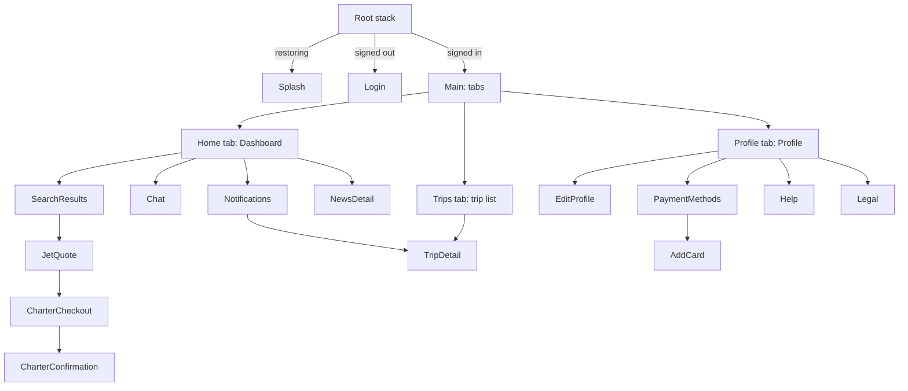

# BackJet app: screens, flows and mock data

Companion to [feature-docs/dashboard](../dashboard/README.md), which specifies the home screen in detail. This page covers the rest of the app and how the screens connect.

## Navigation

- Types live in `src/app/navigation/types.ts`.
- Screens never take a navigation prop. Each takes callbacks (`onBooked`, `onOpenTrip`, ...), and the `*Routes.tsx` files adapt routes to them.
- Each tab is a single screen. Everything a tab opens sits in the root stack, so the tab bar shows on the three tabs only.
- A confirmation's **View trip** pops back to the Trips tab, then opens the trip, so Back lands on the list.

## UI rules

- **Luxury rules:** gold is a detail (icons, the selected state, hairlines), never a big surface. Solid calls to action use `primaryAction`: ink on light, ivory on dark. Screens sit on warm ivory (`secondaryBackground`); cards are white with a hairline edge (`Card`), not grey blocks. Headlines, prices and references use the serif (`blackJetFonts.display`: Baskerville on iOS, the system serif on Android); small labels are tracked capitals (`AppText variant="label"`). Use icons from `Icon`, not text glyphs like › or ✓.
- **Enums, not raw text:** a value the app branches on is an `enum` (`SessionStatus`, `TripType`, `BookingStatus`, `PaymentMethodKind`, `ThemeMode`, `ButtonVariant`…), never a string compared by hand. Enum values match what the API sends, so DTOs use the same enums. ESLint (`no-restricted-syntax` in `.eslintrc.js`) rejects `=== 'text'` and `case 'text':` in `src`; only `typeof` and `Platform.OS` checks may compare strings.
- **Validation:** a field's problem shows right under it, with a red outline (`FormField error`, `FieldError`). Nothing shows until the first submit; then each error follows the typing and clears once fixed. Domain code gives one problem per field (`profileErrors`, `newCardErrors`, `travellerErrors`, `credentialErrors`, `draftFieldErrors`); a snackbar or line under the form is only for problems no single field owns, such as a declined payment.
- **Copy:** sentence case; guests, not passengers; Australian English ("Return" for a round trip, day-first dates, $ for AUD).
- **Colours:** `AppColors` (`src/core/theme/app-colors.ts`) owns every colour: a light and a dark palette by role, plus `fixed` colours for photos and card art. Screens read the palette with `useBlackJetTheme()`; no hex codes in feature code.
- **Spacing:** `AppSpacing` (`src/core/theme/app-spacing.ts`) owns every gap, on the 4/8 pt grid. No raw numbers for gaps.
- **Bottom actions:** a detail screen's buttons go in `BottomActions` (`src/core/ui/BottomActions.tsx`), pinned under the scrolling content. The last button sits safe area + 8 pt (`AppSpacing.bottomActionInset`) above the bottom edge. This holds for every pinned action button: `BottomActions` and the floating `SelectionBar` alike.
- **Tab content** ends safe area + `AppSpacing.tabBar` from the bottom, so it clears the floating tab bar.
- **Theme:** Profile → Preferences → Appearance picks System, Light or Dark (`preferences-slice.ts`). `App.tsx` passes it to `Appearance.setColorScheme`, so native views follow too.
- **Language:** English and Vietnamese. Strings live in `src/core/i18n/strings/en.ts` and `vi.ts`; `vi` must list every key `en` has (a type error otherwise). Components call `const t = useT()` and `t('home.title')`.
- Preferences live in memory only: a relaunch starts from System and English.

## Session

| State | Shown | Changes on |
|---|---|---|
| `restoring` | Splash | `restoreSession` answers |
| `signedIn` | Main and the inbox screens | `restoreSession` returns a user, or `signIn` |
| `signedOut` | Login | `restoreSession` returns null, or `signOut` |

- The mock restores the demo user at launch, so a fresh install opens signed in.
- `session-slice.ts` follows the auth endpoints through RTK Query matchers. `updateProfile` replaces the user in place.

## Booking model

- **Booking:**
  - `kind`: `seats` (shared flight) or `charter` (whole aircraft)
  - `status`: `confirmed` or `cancelled`
  - one or more `legs`
  - passengers, contact email, total, payment label, notes
- A trip is **upcoming** while its first leg is in the future and it is not cancelled.
- It **can be cancelled** until 24 hours before the first departure (`CANCELLATION_WINDOW_HOURS`).
- **Payment:**
  - Cards are validated with Luhn, an `MM/YY` expiry in the future and a 3–4 digit CVC.
  - The wallet balance is checked and deducted when you pay.
  - The default method cannot be removed, and neither can the wallet.

### Seeded data (dated from "now" at launch)

| Ref | Kind | Route | State |
|---|---|---|---|
| BJ4F7Q | Shared seats | GVA → NCE | Upcoming |
| BJR8MX | Charter, 2 legs | FAB → NCE → FAB | Upcoming, paid by wallet |
| BJ2KQP | Charter | LBG → OLB | Flown |
| BJX5TN | Shared seats | GVA → DXB | Cancelled |

Payment methods:
- Visa •••• 4242 (default)
- BlackJet Wallet, €25,000
- Amex •••• 1005

## Inbox

- **Notifications** (`nt-1`…`nt-5`):
  - crew update for BJ4F7Q
  - empty-leg offer
  - catering confirmed for BJR8MX
  - wallet top-up
  - welcome home from Olbia
  - The first two are unread.
- **Concierge thread:** Sophie Laurent. The last two messages are unread, so the chat badge starts at 2.
- **Replies:** `InboxMockDataSource.sendMessage` waits twice the latency, then answers with `conciergeReplyTo(text)`:

| Message mentions | Reply about |
|---|---|
| catering, food, menu, champagne… | The chef calls to set the menu |
| pet, dog, cat | Pets welcome on charters |
| cancel, change, refund | Free until 24 h before departure |
| price, quote, cost | Quotes held 24 h, empty legs |
| car, transfer, chauffeur | A chauffeur to the aircraft steps |
| thanks | My pleasure |
| anything else | Confirmation within the hour |

- **Optimistic updates:**
  - Marking read clears the dot at once.
  - Sending shows the member's bubble at once and the typing dots until the reply arrives.

## Profile

- **Stats:**
  - confirmed trips
  - upcoming trips
  - wallet balance (counts up from the previous value)
- **Personal information:** name and phone are editable; the email is the sign-in and is read-only.
- **Notification toggles:** UI preferences in `settings-slice.ts`. The demo sends no pushes.
- **Add card:**
  - The number groups in fours and the expiry gets its slash as you type.
  - The preview card turns over to its back while the CVC field has focus.

## Motion

| Where | Motion |
|---|---|
| Lists and sections | `FadeInDown` cascades, 60–90 ms apart |
| Pressables | `PressableScale`: sinks to 0.98 under the finger |
| Headers with photos | Parallax: half-speed scroll, stretch when pulled |
| Prices and stats | `CountUp`: ease-out over 600 ms |
| Tab bar | Spring indicator slides to the current tab |
| Checkout | Selection bar springs up from below |
| Chat | Typing dots rise in turn; the send button zooms in with a spring |
| Add card | 3D flip, 500 ms ease-in-out |
| Login | Ken Burns photo drift; the form shakes on error |

Haptics (`src/core/ui/haptics.ts`):
- selection when choosing
- light when sending or confirming
- success when booked or saved
- error when a form is rejected
